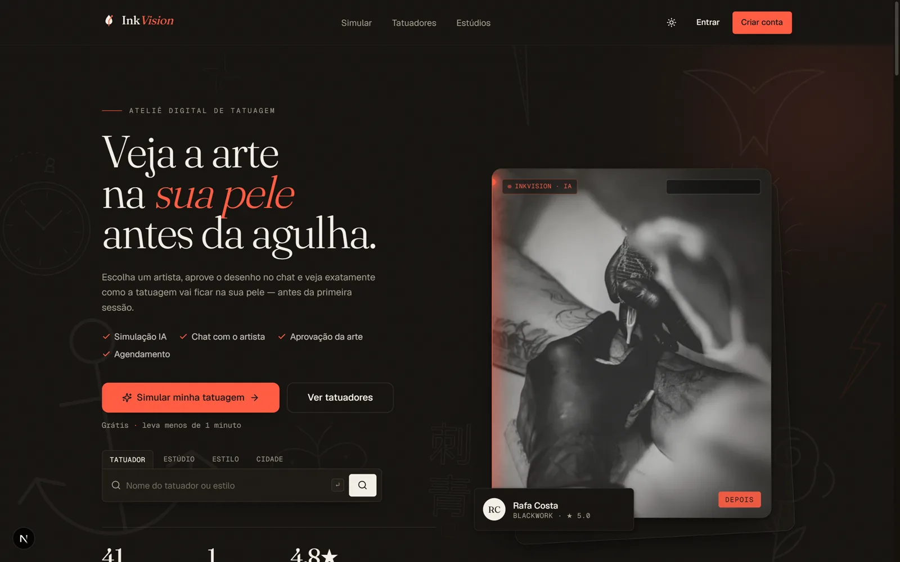

# InkVision

[Português](README.pt-BR.md)

Multi-tenant SaaS for tattoo studios — artist discovery, briefing, quotes, real-time chat, artwork generation, **AI simulation of the tattoo on the client's photo**, scheduling and payments.

Full architecture in [`docs/ARCHITECTURE.md`](docs/ARCHITECTURE.md).

> **Type:** own product (SaaS) under development, with no production deployment yet. Payments, storage and AI use simulated providers by default. The interface is in Portuguese.



## Stack

Next.js 15 · React 19 · TypeScript · TailwindCSS v4 · shadcn/ui · Framer Motion · Prisma · PostgreSQL · Redis · Better Auth · Socket.IO · BullMQ · Cloudflare R2 · Stripe · Docker/Coolify.

## Monorepo

```
apps/     web (Next.js)  ·  realtime (Socket.IO)  ·  worker (BullMQ)
packages/ core  ·  db (Prisma)  ·  ai  ·  shared  ·  config
```

## Development setup (no Docker)

```bash
pnpm install
pnpm setup:local     # starts Prisma's local Postgres, writes .env,
                     # applies schema + RLS and the demo seed
pnpm dev             # web :3000 · realtime :4000 · worker
```

Test accounts and the full manual test script are in **[TESTING.md](TESTING.md)** (Portuguese).
Health check: `GET /api/health` → `{ status: "ok", db: "up" }`.

> Docker alternative: `cp .env.example .env && pnpm infra:up && pnpm db:migrate && pnpm db:seed`.

## Layers (Clean Architecture)

```
apps/web  (presentation + composition root)
  → @inkvision/core       domain + application (use cases, ports, DTOs) — pure, no IO
  → @inkvision/infra      Prisma repositories (implement the core ports)
  → @inkvision/db         Prisma client + tenant extension + withStudio (RLS)
  → @inkvision/shared     shared types/constants
```

## Status by sprint

- **Sprint 0 — Foundation ✅** monorepo, Docker, Prisma (full schema + multi-tenant extension), Better Auth (e-mail/password + roles), shadcn dark/light theme, green production build.
- **Sprint 1 — Multi-tenancy + studios ✅** RLS (`prisma/rls.sql` + `withStudio`), `packages/core` (studio use cases with authorization), `packages/infra` (Prisma repositories), auth UI, admin panel (studio CRUD), owner onboarding, public page `/s/[slug]`.
- **Sprint 2 — Artists + portfolio ✅** owner adds artists, artists edit profile/styles, portfolio (image/before-after) with **mocked** upload (`MockStorageService` — swap for R2 without touching use cases), likes and comments, public discovery `/tatuadores` (style filter), public profile `/t/[artistId]`. Refined RLS: `ArtistProfile`/`PortfolioItem` are publicly readable but tenant-writable. 21 tests.
- **Sprint 3 — Discovery + home + SEO ✅** complete **static/ISR** home (animated hero with search, categories, top artists, masonry gallery, testimonials, FAQ, CTA) with Framer Motion (respects `prefers-reduced-motion`), shared marketing layout, `/estudios`, caching with `unstable_cache` + tags, and SEO (metadata, OG, JSON-LD Organization/WebSite/FAQ, dynamic `sitemap.xml`, `robots.txt`).
- **Sprint 4 — Orders + quotes ✅** `Order` state machine (16 states, transitions validated in the domain), order creation with briefing + reference upload (mock storage), artist quote, client acceptance (→ DEPOSIT_PENDING), cancellation, `OrderEvent` history (timeline), in-app notifications. RLS gained a client context (`withUser` + "tenant OR owner" policy) so clients can read their orders across studios.
- **Sprint 5 — Real-time chat ✅** `apps/realtime` service (Socket.IO, thin relay authorised by signed room tokens — no database), per-order chat (text/image/audio/video/PDF via mock storage), typing indicator, sent/read receipts, message notifications. Persistence and authorisation live in web (RLS); realtime only relays. Verified end to end. Future reinforcement: Redis adapter for realtime.
- **Sprint 6 — Payments ✅** **mocked** gateway (`MockPaymentGateway`): connect the studio account, deposit (application fee), **idempotent** confirmation → `DEPOSIT_PAID`, final payment, billing (subscription + **artist-limit gate**).
- **Sprint 7 — AI layer ✅** pluggable `packages/ai` (ports + env-based registry, `MockAiProvider` + stubs). Flow: artwork → approval → body photo → **AI simulation** (in-process queue in dev, BullMQ `apps/worker` ready) → client reviews and approves. `AiUsageLog`, realtime `simulation:done`.
- **Sprint 8 — Simulation editor ✅** interactive editor (drag the artwork over the photo, scale/rotation), generation with the chosen placement, "adjust position", S/M/L variants.
- **Sprint 9 — Scheduling ✅** weekly artist availability + days off, slot generation (`generateSlots`, pure), client booking (`SIMULATION_APPROVED → SCHEDULED`) with conflict blocking, rescheduling — **unlocks the final payment** (`SCHEDULED → COMPLETED`).
- **Sprint 10 — Reviews ✅** client reviews after completion (`COMPLETED → REVIEWED`), artist rating recalculation, reviews on the public profile. **Sign-up → review loop closed.**
- **Sprint 11 — Admin + LGPD ✅** dashboard metrics (MRR, revenue, studios, AI usage, charts) through an admin RLS bypass (`withAdmin`), audit logs and LGPD self-service at `/conta` (JSON data export + account deletion with anonymisation).
- **Sprint 12 — Hardening ✅** security headers (CSP, HSTS, X-Frame-Options, etc.) verified on the real server, sliding-window rate limiting on the upload route, origin check (CSRF), free-text sanitisation and **PWA** (manifest + offline service worker). Checklist in [docs/SECURITY.md](docs/SECURITY.md).
- **Full flow verified end to end against a real Postgres**: `verify-flow.ts` (quote → review) and `verify-admin.ts` (cross-tenant metrics + authorisation). 59 tests.
- **Deploy ready ✅** Dockerfiles (standalone web, realtime, worker, migrate/init), `docker/compose.prod.yml`, initial migration, init that creates the non-superuser role and applies RLS, and the guide [docs/DEPLOY.md](docs/DEPLOY.md) (Docker Compose and Coolify). Only running it on the VPS is left.

`AI_SIMULATION_PROVIDER=mock` (default) runs without keys. `pnpm dev` starts web + realtime + worker.

For the full dev setup, `pnpm dev` starts web (3000) + realtime (4000) through Turbo.

> If port 3000 is busy, run the web app on another port (`pnpm --filter @inkvision/web start -p 3100`).

### Tests

```bash
pnpm -r test                              # unit tests (no database)
RUN_DB_TESTS=1 pnpm --filter @inkvision/db test   # isolation integration tests (needs Postgres)
```

CI runs typecheck, unit tests and the web build, plus an end-to-end job (Playwright) against Postgres with the production migration + RLS path.

### Demo seed

`pnpm seed:demo` only runs against a local database. Seeding a remote demo database requires `ALLOW_DEMO_SEED=true` and `DEMO_SEED_PASSWORD` (12+ characters); with `NODE_ENV=production` the seed also requires that opt-in.

## Security

Reporting policy in [SECURITY.md](SECURITY.md); technical checklist in [docs/SECURITY.md](docs/SECURITY.md).

## License

No license has been chosen yet; all rights reserved by the author.
